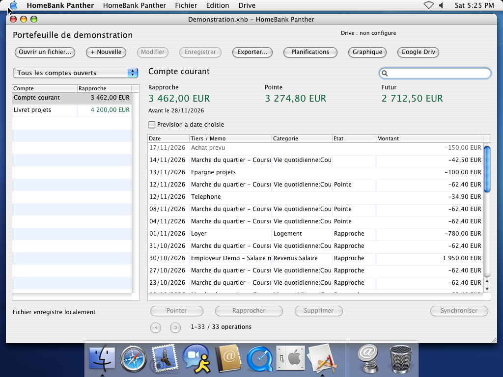
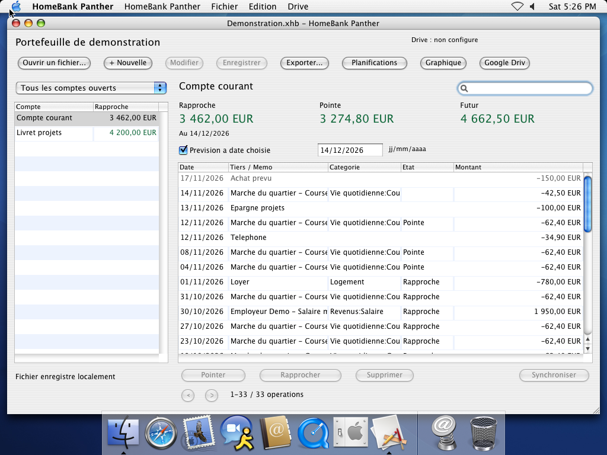
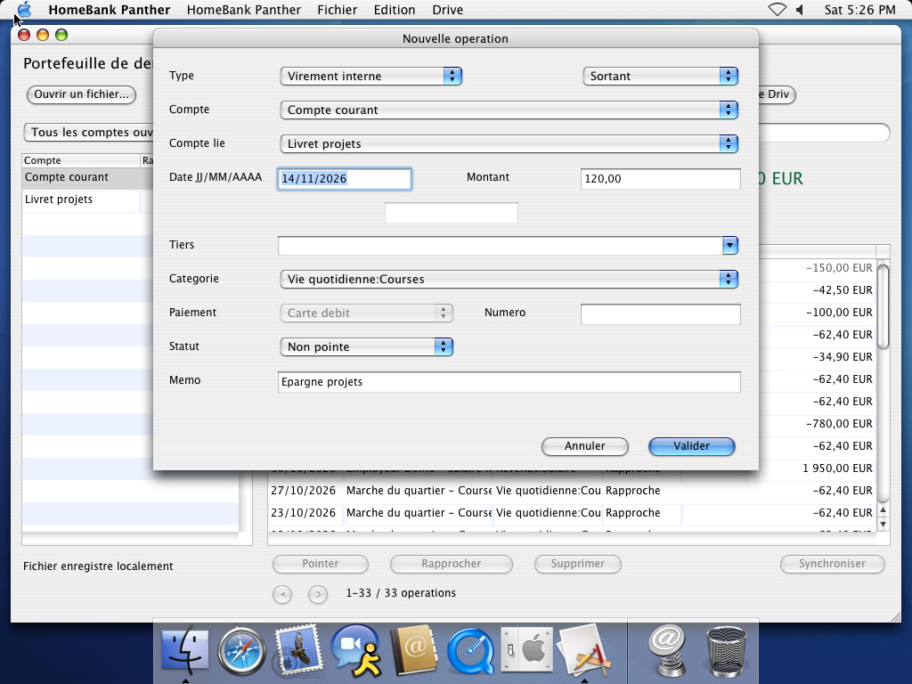
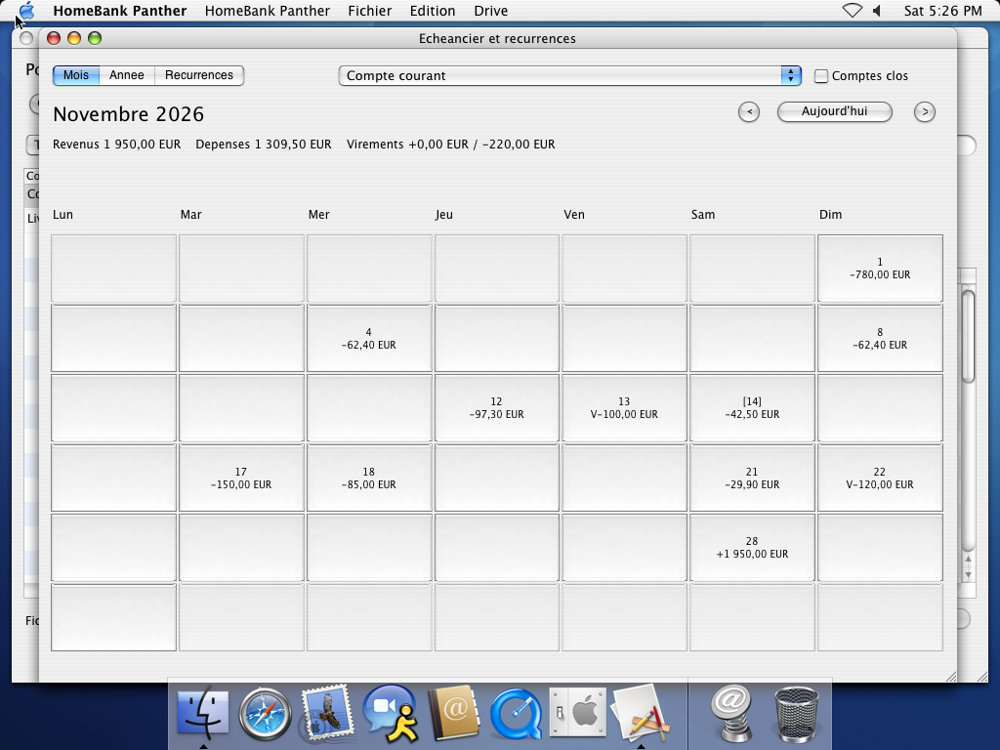
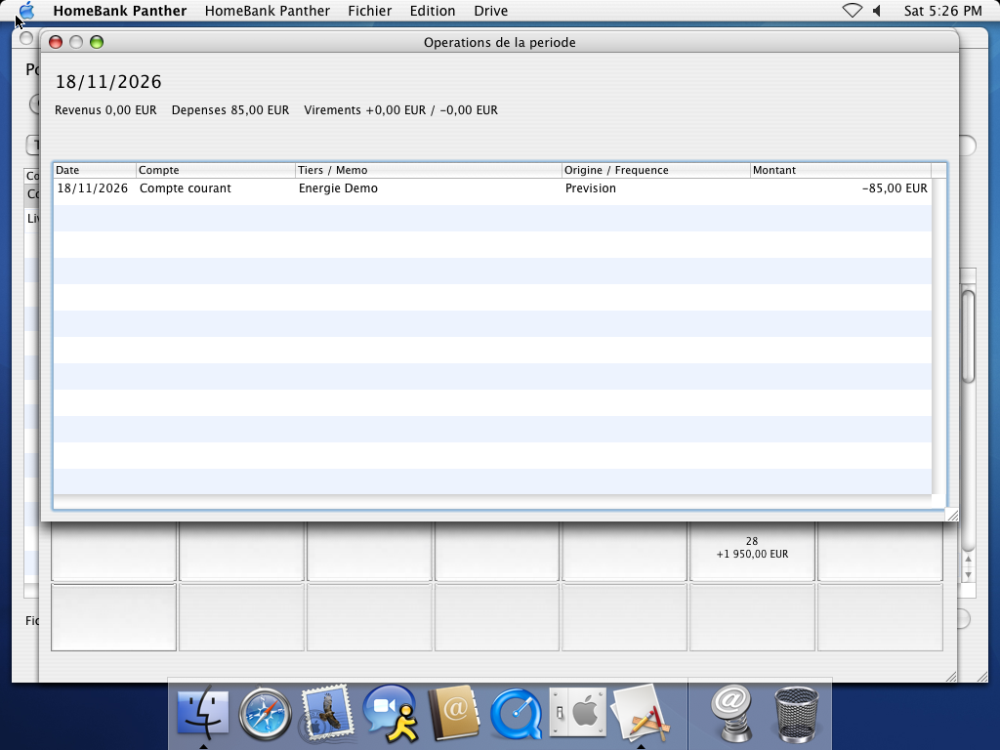
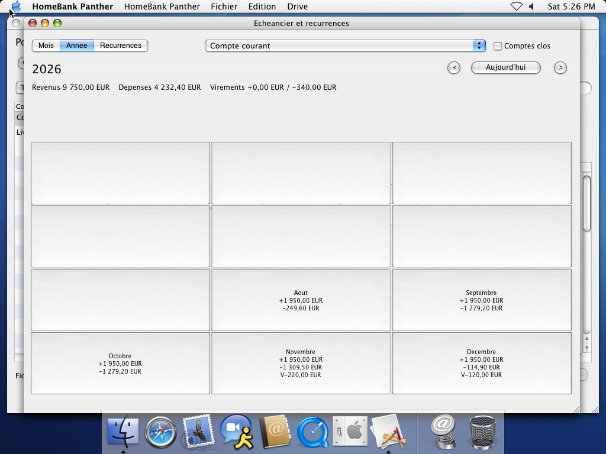
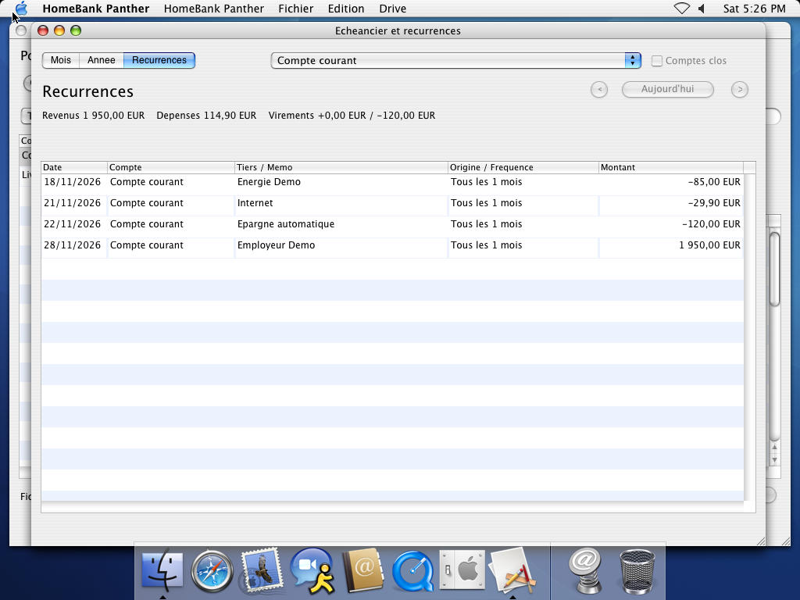
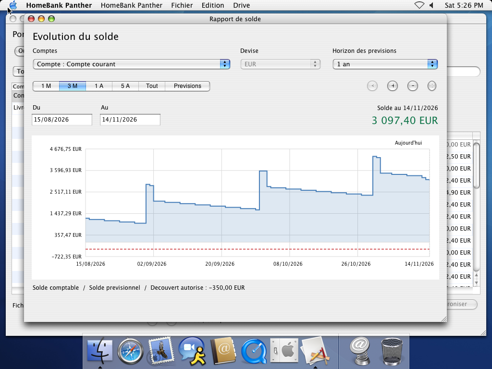
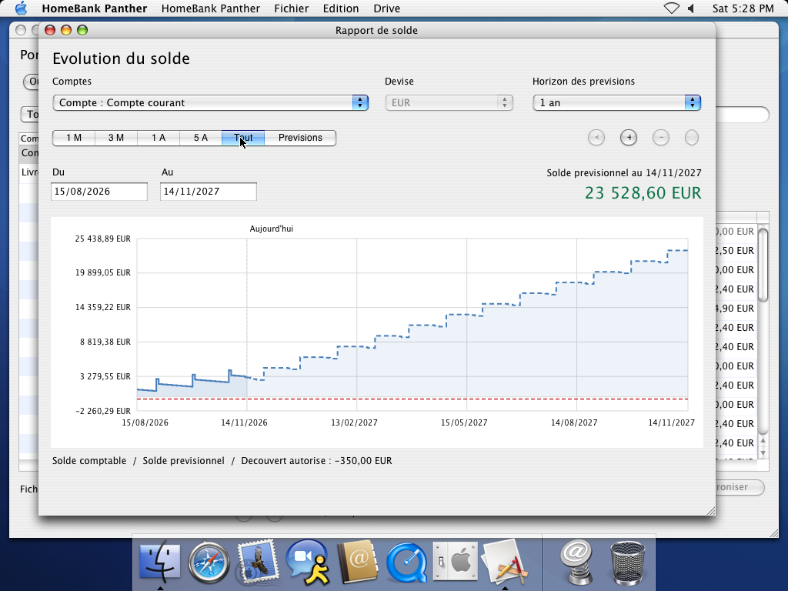
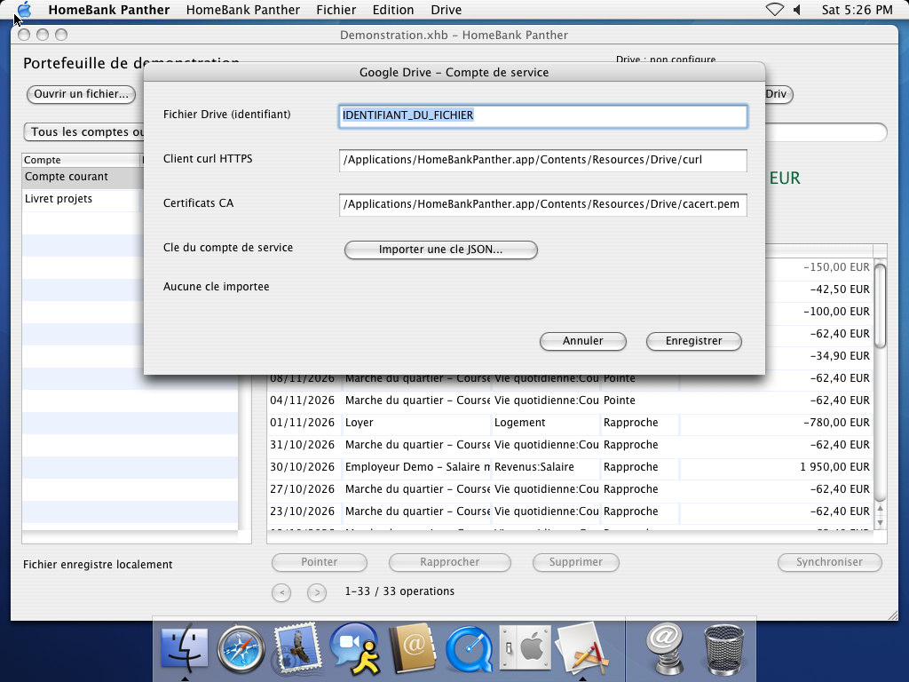

# Guide utilisateur — HomeBank Panther

**Version 0.6.0 · Mac OS X 10.3.9 · PowerPC**

Ce guide accompagne la consultation de vos comptes, la saisie de vos opérations, les prévisions et la synchronisation de votre fichier HomeBank. Il s’adresse à l’utilisateur de l’application ; la compilation et les composants HTTPS sont décrits dans le [guide technique](README_TECHNIQUE.md).

Les captures de ce guide proviennent de **la VM QEMU sous Mac OS X 10.3.9**, avec les vues natives de la version 0.6.0 et un **portefeuille entièrement fictif**. Les dates et les montants servent à illustrer les fonctions. L’écran de configuration Drive est présenté sans clé et sans connexion à un compte réel.

## Sommaire

1. [Bien démarrer](#bien-demarrer)
2. [Se repérer dans la fenêtre principale](#fenetre-principale)
3. [Comprendre les soldes et les couleurs](#soldes)
4. [Prévoir le solde avant salaire ou à une date choisie](#previsions)
5. [Rechercher et consulter les opérations](#consulter)
6. [Ajouter une dépense ou un revenu](#saisir)
7. [Effectuer un virement interne dans le fichier](#virements)
8. [Modifier, pointer, rapprocher et supprimer](#verifier)
9. [Consulter les planifications et le calendrier](#calendrier)
10. [Explorer le graphique de solde](#graphique)
11. [Enregistrer, consolider et exporter](#enregistrer)
12. [Utiliser Google Drive](#drive)
13. [Fermer, reprendre et récupérer son travail](#recuperer)
14. [Résoudre les problèmes courants](#depannage)
15. [Raccourcis et glossaire](#raccourcis)

## 1. Bien démarrer

### Préparer l’application

HomeBank Panther est une application native pour Mac PowerPC sous **Mac OS X 10.3.9**. Une application déjà compilée peut être exécutée sans Xcode. Pour préparer votre propre application dans la VM, suivez le [guide d’installation et de compilation](README_TECHNIQUE.md#compiler-dans-la-vm-panther).

L’application ouvre les fichiers HomeBank **`.xhb` UTF-8 non chiffrés**, jusqu’au format **1.6**, dans la limite de **8 Mio**. Elle organise les données de votre fichier et n’exécute aucun paiement auprès d’une banque.

### Découvrir l’application sans toucher à ses comptes

1. Lancez **HomeBank Panther**.
2. Cliquez sur **Ouvrir un fichier…**, ou choisissez **Fichier > Ouvrir…**.
3. Sélectionnez le fichier `tests/demo.xhb` fourni dans les sources.
4. Sélectionnez un compte dans la liste de gauche.
5. Explorez les soldes, le calendrier et le graphique.

Le fichier de démonstration contient des données fictives. Les captures de ce guide utilisent un autre portefeuille fictif, plus fourni : leurs montants ne seront donc pas ceux du fichier `demo.xhb`.

### Ouvrir son portefeuille

1. Conservez une copie de votre fichier d’origine.
2. Ouvrez le `.xhb` que vous souhaitez utiliser dans Panther.
3. Vérifiez les noms des comptes, leurs devises et les soldes.
4. Attendez la fin du chargement avant de commencer la saisie.

Si un import échoue, le portefeuille précédemment ouvert reste disponible. Un fichier local fonctionne sans accès à Internet et sans configuration Google.

## 2. Se repérer dans la fenêtre principale

| Zone | Utilisation |
| --- | --- |
| Liste des comptes, à gauche | Sélectionner le compte à consulter. Le montant associé est son solde rapproché. |
| Filtre au-dessus des comptes | Afficher tous les comptes ouverts, les comptes Banque ou l’Épargne. |
| Soldes en haut de la zone principale | Lire les soldes rapproché, pointé et futur du compte sélectionné. |
| Option de prévision | Remplacer l’horizon automatique par une date choisie. |
| Champ de recherche | Filtrer les opérations du compte sélectionné. |
| Tableau des opérations | Consulter la date, le tiers ou mémo, la catégorie, l’état et le montant. |
| Barre de boutons supérieure | Ouvrir un fichier, ajouter ou modifier une opération, enregistrer, exporter, ouvrir les planifications ou le graphique, accéder à Drive. |
| Boutons sous les opérations | Pointer, rapprocher ou supprimer l’opération sélectionnée. |
| Bas de fenêtre | Lire l’état de l’enregistrement local, changer de page et lancer une synchronisation. |

La liste principale présente **uniquement les comptes ouverts**. Les comptes clos sont accessibles sur demande dans le calendrier. Les opérations sont paginées par groupes de **100** ; les boutons `<` et `>` sous le tableau passent d’une page à l’autre.

Les libellés de l’interface peuvent être affichés sans accents, par exemple `Prevision a date choisie` ou `Recurrences`. Ce guide emploie leur orthographe française habituelle.

## 3. Comprendre les soldes et les couleurs

### Les trois soldes

| Solde | Ce qu’il représente |
| --- | --- |
| **Rapproché** | Le solde initial du compte, augmenté ou diminué des opérations rapprochées. C’est le repère principal. |
| **Pointé** | Le solde initial, les opérations rapprochées et les opérations pointées. |
| **Futur** | Le montant prévisionnel selon le mode actif : avant le prochain salaire, à une date choisie ou à partir des opérations inscrites seules. |

Les opérations **annulées** ne contribuent pas à ces soldes. Une prévision ne modifie ni le solde rapproché ni le solde pointé et ne crée aucune opération.

### Lire les couleurs

- **Vert** : montant strictement positif.
- **Orange** : montant nul ou négatif qui reste dans la limite du découvert autorisé.
- **Rouge** : montant inférieur à cette limite.

Par exemple, avec un découvert autorisé de **350 €**, un solde de **−120 €** reste orange ; un solde de **−420 €** devient rouge. La limite provient du compte dans votre fichier HomeBank ; son paramétrage se fait dans HomeBank original.

Les comptes de devises différentes ne sont pas additionnés arbitrairement. Le graphique propose un choix de devise pour ses vues regroupées.

## 4. Prévoir le solde avant salaire ou à une date choisie

### Prévision automatique avant le prochain salaire

Sur un compte bancaire, Panther recherche une prochaine rentrée de salaire. Il examine les catégories, y compris les sous-catégories, ainsi que le mémo. Les mots comme **salaire**, **salaires**, **paie**, **salary** ou **payroll** peuvent servir de repère.

En l’absence de désignation explicite, un revenu récurrent dominant peut être identifié automatiquement. Cette détection repose sur son importance relative aux autres revenus et dépenses récurrents ; l’indication **revenu estimé** permet de la distinguer d’un salaire explicitement nommé. Les règles détaillées figurent dans le [guide technique](README_TECHNIQUE.md).

Le calcul additionne :

1. le solde initial du compte ;
2. les opérations inscrites non annulées avant la journée du prochain salaire ;
3. les échéances récurrentes restantes à partir d’aujourd’hui, avant cette même journée.

**La journée du prochain salaire est entièrement exclue**, y compris les autres mouvements datés de ce jour. Un salaire déjà inscrit à une date future peut fixer cette borne, même si HomeBank a déjà avancé sa prochaine récurrence.

La mention **Avant le …** sous les soldes précise l’horizon retenu. La recherche automatique des prochaines échéances de salaire est bornée à 366 jours. Si aucun salaire n’est reconnu, le mode par défaut conserve le solde des opérations inscrites.

### Exemple de budget avant salaire

Vous disposez de **1 100 €** en tenant compte des mouvements inscrits avant le prochain salaire. Il reste avant cette date une facture planifiée de **85 €** et un virement récurrent sortant de **120 €**. Le solde futur devient **895 €**.

Le salaire suivant n’est pas ajouté : la prévision répond à la question « que restera-t-il avant cette rentrée ? ». Les dépenses imprévues ou absentes du fichier ne peuvent pas être anticipées.

### Choisir soi-même la date

1. Sélectionnez le compte.
2. Cochez **Prévision à date choisie**.
3. Saisissez une date au format **jj/mm/aaaa**, aujourd’hui ou plus tard.
4. Attendez la fin du calcul en arrière-plan.
5. Vérifiez la mention **Au …** et le solde futur affiché.

Dans ce mode, **la journée choisie est incluse**. Une date correspondant au jour du salaire inclut donc ce salaire et les autres mouvements de cette journée.

L’option est disponible sur tous les comptes ouverts, **même avec un salaire détecté**, et sur les comptes d’épargne. Chaque compte conserve son choix pendant la session. Une ouverture explicite de fichier ou un nouveau chargement Drive remet ces choix à zéro ; ils ne sont pas enregistrés dans le fichier HomeBank.

Pour revenir au fonctionnement automatique, décochez l’option. Une date invalide ou passée affiche une prévision indisponible : corrigez la date pour relancer le calcul.

### Comprendre les limites de la prévision

- Les échéances en retard ne sont pas ajoutées automatiquement ; une mention signale leur exclusion.
- Une prévision se base sur les opérations et les récurrences présentes dans le fichier, pas sur le solde en ligne de votre banque.
- Les dates de prochaine échéance maintenues par HomeBank déterminent ce qui reste planifié. Un modèle dont la date n’a pas été avancée après publication peut conduire à compter un mouvement déjà saisi ; corrigez cette situation dans HomeBank original.
- Si une récurrence est invalide ou si le calcul est incomplet, le montant est remplacé par `--` avec une explication.
- L’indication `...` signifie que le calcul est en cours. Les changements rapides de compte ne doivent pas vous faire lire le résultat du compte précédent.

## 5. Rechercher et consulter les opérations

Sélectionnez d’abord un compte. Le champ de recherche filtre **ce compte**, sur le tiers, le mémo, la catégorie, le numéro de paiement et le montant affiché. La recherche ne distingue pas les majuscules des minuscules.

Par exemple :

- `Courses` retrouve un mémo ou une catégorie contenant ce texte ;
- le nom d’un tiers retrouve ses opérations ;
- une référence de chèque ou de carte retrouve son numéro de paiement.

Effacez la recherche pour retrouver la liste complète du compte. Le changement de recherche revient à la première page. Les dates futures sont présentées en gris ; une opération future déjà inscrite peut apparaître dans cette liste, contrairement à une simple récurrence encore non publiée.

Une sélection dans le tableau permet d’utiliser **Modifier**, **Pointer**, **Rapprocher** ou **Supprimer**. Un double-clic ouvre l’éditeur de l’opération.

## 6. Ajouter une dépense ou un revenu

1. Sélectionnez le compte concerné.
2. Cliquez sur **+ Nouvelle**, ou utilisez **Fichier > Nouvelle opération**.
3. Choisissez **Dépense** ou **Revenu** dans **Type**.
4. Vérifiez le compte et la date.
5. Saisissez le montant en valeur positive, par exemple `42,50`. Le type détermine son sens.
6. Complétez les champs utiles.
7. Cliquez sur **Valider**.
8. Vérifiez la nouvelle ligne et attendez la confirmation de son enregistrement local en bas de fenêtre.

| Champ | Ce qu’il faut renseigner |
| --- | --- |
| Type | Dépense, Revenu ou Virement interne. |
| Compte | Le compte qui porte l’opération. |
| Date | Une date au format JJ/MM/AAAA, éventuellement future. |
| Montant | Le montant de l’opération ; son signe est déterminé par le type et, pour un virement, sa direction. |
| Tiers | Le bénéficiaire ou l’émetteur. Choisissez un tiers existant ou saisissez son nom. |
| Catégorie | Une catégorie existante, avec sa hiérarchie, ou Sans catégorie. |
| Paiement | Le mode de paiement HomeBank : carte, chèque, espèces, prélèvement, etc. |
| Numéro | La référence associée au paiement, distincte du tiers et du mémo. |
| Statut | Non pointé, Pointé, Rapproché ou Annulé. |
| Mémo | Le commentaire libre décrivant l’opération. |

Les catégories sont présentées sous la forme **catégorie:sous-catégorie**. La gestion de leur arborescence se fait dans HomeBank original.

Si une valeur est refusée, l’éditeur affiche un message et reste ouvert. Corrigez le champ indiqué, puis validez à nouveau. **Annuler** ferme l’éditeur sans appliquer la saisie.

Choisir un mode de paiement appelé « Récurrent » ne crée pas à lui seul une planification : les modèles récurrents sont gérés dans HomeBank original.

## 7. Effectuer un virement interne dans le fichier

Un virement interne représente un déplacement d’argent entre deux comptes de votre portefeuille. Il crée des écritures liées dans le fichier ; il ne transmet aucun ordre bancaire.

1. Cliquez sur **+ Nouvelle**.
2. Choisissez **Virement interne**.
3. Sélectionnez le **Compte** et le **Compte lié**, qui doivent être différents.
4. Choisissez la direction : **Sortant** depuis le compte sélectionné, ou **Entrant** vers ce compte.
5. Renseignez la date et le montant.
6. Si les devises diffèrent, renseignez également le **Montant compte lié** dans sa propre devise. Panther ne devine pas le taux de change.
7. Ajoutez éventuellement un mémo et validez.
8. Consultez les deux comptes pour vérifier leurs mouvements respectifs.

Dans une même devise, les deux montants se compensent. Entre devises différentes, chaque compte garde son montant propre. Pour déplacer 120 € du compte courant vers un livret en euros, choisissez le compte courant, le livret comme compte lié, la direction Sortant et le montant `120,00`.

Le pointage et le rapprochement restent propres à chaque mouvement. L’annulation ou la suppression d’un virement concerne ses deux mouvements liés. Un virement existant ne peut pas être converti directement en dépense ou en revenu.

## 8. Modifier, pointer, rapprocher et supprimer

### Modifier une opération

1. Sélectionnez l’opération.
2. Cliquez sur **Modifier**, ou double-cliquez sur sa ligne.
3. Ajustez les champs disponibles.
4. Cliquez sur **Valider** et attendez l’enregistrement local.

Certaines valeurs sont protégées sur les opérations rapprochées, les virements dont une face est rapprochée ou les opérations ventilées. Une ventilation répartit une opération entre plusieurs catégories ; Panther ne propose pas d’éditeur de ventilation.

Pour changer un montant protégé par le rapprochement, retirez d’abord le rapprochement du ou des mouvements concernés, puis effectuez la modification et rapprochez de nouveau après vérification. La protection des ventilations ne disparaît pas avec ce changement de statut.

### Pointer

Le pointage permet de marquer un mouvement que vous avez vérifié.

1. Sélectionnez une opération non rapprochée.
2. Cliquez sur **Pointer**.
3. Son état devient Pointé et le solde pointé est recalculé.

Le bouton devient **Dépointer** pour revenir à Non pointé. Une opération rapprochée doit d’abord être dérapprochée avant d’être pointée.

### Rapprocher

Le rapprochement marque l’opération comme vérifiée dans votre suivi bancaire.

1. Comparez sa date et son montant avec votre relevé.
2. Sélectionnez-la dans Panther.
3. Cliquez sur **Rapprocher**.
4. Vérifiez le solde rapproché.

Le bouton devient **Dérapprocher** pour retirer ce statut. Ce retrait ramène l’opération à Non pointé ; il ne conserve pas automatiquement un pointage antérieur.

### Annuler ou supprimer

Le statut **Annulé**, accessible dans l’éditeur, conserve une ligne visible tout en l’excluant des soldes. Pour retirer l’opération, utilisez **Supprimer** et lisez la confirmation, notamment lorsqu’il s’agit d’un virement lié.

Il n’existe pas de commande générale d’annulation des modifications comparable à un historique « Annuler/Rétablir ». Pour récupérer une suppression, utilisez une copie ou une sauvegarde appropriée.

## 9. Consulter les planifications et le calendrier

Cliquez sur **Planifications**, ou choisissez **Fichier > Planifications**. Trois vues sont disponibles : **Mois**, **Année** et **Récurrences**.

### Vue mensuelle

1. Choisissez **Mois**.
2. Sélectionnez un compte ou **Tous les comptes**.
3. Utilisez `<` et `>` pour changer de mois.
4. Utilisez **Aujourd’hui** pour revenir à la période courante.
5. Consultez les totaux, puis cliquez sur une journée pour ouvrir ses opérations.

Les cellules présentent les flux de la journée. Les virements sont distincts des revenus et dépenses : **V+** correspond aux entrées et **V−** aux sorties. Les totaux restent séparés par devise.

Si une cellule contient trop de lignes, elle signale les lignes supplémentaires. Son info-bulle et le détail de la journée permettent de les consulter.

### Détail d’une journée

Le détail affiche les mouvements de la période et leurs totaux. Il permet de comprendre l’origine du montant agrégé ; consulter une échéance ne la publie pas dans le compte.

### Vue annuelle

1. Choisissez **Année**.
2. Utilisez les flèches pour changer d’année.
3. Cliquez sur un mois pour ouvrir sa liste d’opérations.
4. Dans ce détail, utilisez **Afficher le mois** pour passer au calendrier mensuel correspondant.

L’agrégation est faite mois par mois, avec les mêmes règles de dates que la vue mensuelle.

Dans cette version sous Panther, les cases des mois sans mouvement peuvent apparaître vides. Les flèches et l’année indiquée au-dessus permettent de se repérer dans la période.

### Vue des récurrences

Choisissez **Récurrences** pour consulter les modèles HomeBank, leur montant et leur fréquence. Un double-clic sur une récurrence ouvre ses informations de consultation. Le filtre de compte permet de restreindre la liste.

La création, la modification et la publication des modèles récurrents restent dans HomeBank original. Les options de répétition, limites d’occurrences et ajustements de dates existants sont utilisés pour les projections.

### Opérations inscrites et prévisions : les règles de dates

| Période du calendrier | Mouvements affichés |
| --- | --- |
| Jours passés | Opérations inscrites non annulées. |
| Aujourd’hui | Opérations inscrites non annulées. |
| Jours futurs | Opérations inscrites non annulées et échéances encore planifiées. |

Le **solde futur du compte** a une règle différente pour aujourd’hui : il peut également inclure les échéances encore planifiées de la journée. Cette différence explique certains écarts entre une cellule du calendrier et le calcul du solde futur.

Pour consulter un compte clos, cochez **Comptes clos** dans le calendrier, puis sélectionnez-le. Cette option ne change pas la liste principale et n’est pas disponible dans la vue Récurrences.

Un avertissement de projection incomplète signifie que les montants prévisionnels ne doivent pas être considérés comme exhaustifs. Les opérations inscrites restent consultables.

## 10. Explorer le graphique de solde

Cliquez sur **Graphique**, ou choisissez **Fichier > Graphique de solde**.

### Choisir ce que l’on observe

Le sélecteur **Comptes** permet de choisir un compte ouvert, les comptes bancaires regroupés ou l’épargne. En vue regroupée, choisissez aussi la **Devise** si plusieurs sont présentes. Les comptes clos sont exclus du graphique.

Le graphique représente le solde initial augmenté ou diminué des opérations inscrites non annulées à chaque date. Il ne représente pas uniquement les opérations rapprochées : sa valeur peut donc différer du solde rapproché de la fenêtre principale.

### Lire la courbe

- **Ligne bleue et remplissage léger** : évolution du solde.
- **Partie future en pointillés** : projection des mouvements inscrits à venir et des récurrences restantes.
- **Repère d’aujourd’hui** : séparation entre historique et avenir.
- **Ligne rouge en vue individuelle** : limite du découvert autorisé ; en l’absence d’autorisation, le seuil est zéro.

Les vues regroupées ne définissent pas de découvert commun. Le montant présenté au survol correspond au solde de la date inspectée. La valeur finale concerne la fin de la période visible.

### Changer de période et zoomer

| Commande | Effet |
| --- | --- |
| **1 M**, **3 M**, **1 A**, **5 A** | Choisir une période historique prédéfinie. |
| **Tout** | Afficher l’étendue disponible, horizon prévisionnel compris. |
| **Prévisions** | Se placer sur la partie future. |
| **Horizon des prévisions** | Choisir 3 mois, 1 an ou 5 ans de projection. |
| Champs **Du** et **Au** | Définir une plage au format JJ/MM/AAAA. |
| Boutons **+** et **−** | Zoomer ou dézoomer, jusqu’au détail d’une journée. |
| Flèches | Déplacer la période visible. |
| Glissement dans le graphique | Sélectionner une plage de dates. |
| Molette | Déplacer la période. |
| Option + molette | Zoomer autour de la période consultée. |

Cliquez dans le graphique pour y placer le focus, puis déplacez le pointeur pour inspecter les dates. Attendez la fin du calcul après un changement de compte, de devise ou d’horizon.

Les horizons du graphique sont **indépendants** de l’option « Prévision à date choisie » du compte. Le graphique inclut les récurrences futures à partir de demain, tandis que le solde futur du compte peut inclure celles d’aujourd’hui.

Dans cet exemple fictif, **Tout** affiche l’historique et une année de prévisions. Le tracé en pointillés correspond aux seules récurrences et opérations renseignées dans le portefeuille ; il ne prédit pas les dépenses qui n’y figurent pas.

## 11. Enregistrer, consolider et exporter

### Comprendre les trois niveaux

| Action | Résultat | À utiliser pour |
| --- | --- | --- |
| Enregistrement local automatique / **Enregistrer** | Conserver les modifications dans un journal local associé au XML. | Travailler au quotidien dans Panther. |
| **Consolider le fichier XML** | Intégrer les modifications dans le `.xhb` courant. | Réutiliser ce fichier seul ou l’ouvrir dans HomeBank original. |
| **Exporter une copie** | Produire un autre `.xhb` intégrant les modifications. | Partager, archiver ou récupérer le portefeuille courant. |
| **Synchroniser** | Attendre l’enregistrement local, consolider puis envoyer sur Drive. | Mettre à jour le fichier distant configuré. |

### Attendre la confirmation locale

Après une saisie, Panther regroupe les modifications rapprochées et les écrit en arrière-plan. Pendant ce délai, elles sont déjà visibles mais peuvent encore être en cours d’enregistrement.

Lisez l’état en bas de fenêtre :

- **Journal local en cours d’enregistrement…** : attendez avant de quitter ou de changer de fichier.
- **Modifications conservées dans le journal local** : les modifications sont enregistrées localement, mais le XML peut ne pas encore les contenir.
- **Sauvegarde locale échouée : Enregistrer pour réessayer** : cliquez sur Enregistrer ; si nécessaire, exportez une copie avant de quitter.

Une fermeture forcée ou une coupure avant la confirmation peut perdre les modifications encore en mémoire.

### Garder le XML et son journal ensemble

Le fichier compagnon porte un nom du type **`Comptes.xhb.panther-journal`**. Tant que le XML n’a pas été consolidé, conservez-le avec **`Comptes.xhb`**. Il contient des modifications que HomeBank original ne sait pas lire.

Pour transférer un fichier unique à une autre application, utilisez **Consolider le fichier XML** ou **Exporter une copie** plutôt que de copier seulement le `.xhb` non consolidé.

### Consolider

1. Attendez l’enregistrement local.
2. Choisissez **Fichier > Consolider le fichier XML**.
3. Attendez la fin du traitement ; certaines actions sont temporairement indisponibles.
4. Une fois terminé, utilisez le `.xhb` dans l’application de votre choix.

La consolidation conserve une sauvegarde du XML précédent sous un nom du type `Comptes.xhb.backup-XXXXXX`. Une fois la consolidation confirmée, le journal correspondant est nettoyé.

### Exporter une copie

1. Cliquez sur **Exporter…**, ou choisissez **Fichier > Exporter une copie…**.
2. Choisissez un emplacement et un nom différent pour la copie.
3. Attendez la fin de l’export.

L’export contient les modifications du portefeuille courant. Une exportation vers un autre nom ne remplace pas le document de travail ni son journal. Elle n’envoie rien sur Drive.

## 12. Utiliser Google Drive

### Configuration initiale

L’intégration Panther utilise un **compte de service**, auquel votre fichier a été explicitement partagé. Elle n’affiche pas Google Picker et ne demande pas de connexion à votre compte personnel dans Safari.

Le [guide de configuration Drive](DRIVE_SETUP.md) détaille la préparation du compte de service, de la clé JSON et du partage. La mise en place dans Google Cloud demande une machine et un navigateur compatibles avec ce service.

Dans **Drive > Configurer le compte de service…** :

1. Renseignez l’**identifiant du fichier** partagé, pas son URL complète.
2. Vérifiez le chemin du **client curl HTTPS** fourni avec l’application ou le kit HTTPS validé.
3. Vérifiez le chemin des **certificats CA**.
4. Cliquez sur **Importer une clé JSON…**, puis sélectionnez la clé du compte de service.
5. Cliquez sur **Enregistrer** et autorisez l’accès au trousseau si demandé.

La clé est conservée dans le trousseau. La capture ci-dessus présente uniquement le formulaire : aucune authentification ni synchronisation réelle n’a été effectuée pour le guide. Les chemins de certificats sont ceux d’un composant logiciel, pas votre clé privée JSON.

### Charger le fichier partagé

1. Ouvrez **Drive > Ouvrir le fichier Drive**, ou utilisez le bouton **Google Drive**.
2. Attendez le téléchargement et l’ouverture du fichier.
3. Vérifiez le portefeuille chargé et l’indicateur Drive.

La configuration seule ne charge pas automatiquement un portefeuille. Si vous ouvrez ensuite un fichier local, Drive devient inactif pour ce fichier local ; ouvrir un fichier ne l’associe pas arbitrairement au document distant.

### Envoyer les modifications

1. Ajoutez ou modifiez vos opérations.
2. Attendez la confirmation de l’enregistrement local.
3. L’indicateur **Drive : modifications à synchroniser** signale les changements en attente.
4. Cliquez sur **Synchroniser**, ou **Drive > Synchroniser maintenant**.
5. Attendez la fin de la consolidation et de l’envoi avant de fermer l’application.

L’envoi met à jour le fichier distant dans une nouvelle révision. **Sans changement local, Synchroniser charge la version distante.** Ce bouton ne force donc pas systématiquement un envoi.

Les opérations n’entraînent pas de synchronisation automatique. Une sauvegarde locale réussie n’implique pas que la copie Drive soit à jour.

### Échec réseau et conflit

En cas d’échec réseau, les modifications locales restent conservées. Après le rétablissement de la connexion, relancez la synchronisation. Si l’erreur est survenue après consolidation, les modifications peuvent déjà être dans le XML local plutôt que dans le journal.

En cas de **conflit**, le fichier distant a changé depuis la référence locale. L’application bloque l’écrasement et ne propose pas de fusion automatique :

1. Exportez votre portefeuille courant vers une copie distincte.
2. Rechargez la version Drive uniquement après avoir conservé les modifications locales utiles.
3. Comparez les deux copies et reportez les différences nécessaires avant un nouvel envoi.

Évitez de modifier le même portefeuille simultanément dans Panther et HomeBank original. Les révisions Drive complètent vos sauvegardes sans les remplacer.

### Désactiver ou oublier

- **Drive > Désactiver la synchronisation** : conserve la configuration, la clé et les copies locales.
- **Drive > Oublier la configuration et la clé…** : retire la configuration et la clé du trousseau, en conservant les copies locales.

Pour révoquer l’accès côté Google, retirez également le partage du fichier ou supprimez la clé du compte de service dans Google Cloud.

## 13. Fermer, reprendre et récupérer son travail

### Quitter normalement

1. Attendez la fin de l’enregistrement local.
2. Synchronisez si vous souhaitez envoyer vos changements sur Drive.
3. Choisissez **Quitter HomeBank Panther**, ou utilisez Commande-Q.

Si une sauvegarde est en cours, la fermeture est différée : attendez puis recommencez. Si une boîte propose **Enregistrer**, **Annuler** ou **Abandonner**, préférez Enregistrer pour conserver vos changements. Cette action lance l’enregistrement et annule la tentative de fermeture ; quittez à nouveau après sa confirmation.

**Abandonner** ne constitue pas un effacement garanti du journal sur disque : une écriture ayant abouti sans confirmation peut être retrouvée au prochain chargement. Pour un problème de récupération, conservez les fichiers avant toute manipulation.

### Reprendre un portefeuille local

Rouvrez le même `.xhb` avec son journal à côté. Panther relit les modifications locales complètes. Les options de prévision à date choisie doivent être réactivées après cette ouverture.

**Fichier > Recharger** est une ouverture du fichier, pas une commande d’annulation générale. Elle rejoue aussi le journal local valide associé au fichier.

### Restaurer une sauvegarde XML

1. Conservez le fichier actuel et ses fichiers compagnons à part.
2. Faites une copie de la sauvegarde `*.backup-XXXXXX` voulue.
3. Donnez à cette copie un nouveau nom se terminant par `.xhb`.
4. Ouvrez-la dans Panther et vérifiez les opérations.

Une sauvegarde XML antérieure ne contient pas les modifications effectuées après sa création. Ne lui associez pas au hasard le journal d’une autre version.

Si un journal est refusé ou si un fichier a changé en dehors de Panther, n’effacez pas le journal, les fichiers de verrou ou les reçus pour contourner l’erreur. Le [guide technique](README_TECHNIQUE.md) décrit les cas de reprise ; un export du portefeuille encore en mémoire permet souvent de préserver le travail visible.

## 14. Résoudre les problèmes courants

| Symptôme | Vérification et action |
| --- | --- |
| Un compte manque dans la liste principale | Vérifiez le filtre Banque/Épargne et son état ouvert dans HomeBank original. Les comptes clos se consultent dans le calendrier. |
| Le solde futur ne s’arrête pas au salaire attendu | Consultez la date indiquée sous le solde, les catégories et le mémo des récurrences. Utilisez une date choisie si la détection ne correspond pas à votre besoin. |
| Le solde futur paraît trop élevé | Vérifiez les échéances en retard exclues, les dépenses absentes du fichier et la borne du prochain salaire, dont la journée est exclue. |
| La même charge semble comptée deux fois | Vérifiez si elle est déjà inscrite et si son modèle conserve une date de prochaine échéance obsolète. Corrigez le modèle dans HomeBank original. |
| La prévision affiche `--` | Corrigez une date passée ou mal saisie. Consultez l’explication ou l’info-bulle pour une récurrence invalide ou une projection incomplète. |
| Une dépense récurrente n’apparaît pas dans une cellule | Vérifiez la date réelle de prochaine échéance, le compte filtré et la période. Aujourd’hui et le passé n’affichent que les opérations inscrites dans le calendrier. |
| Un montant ou une date n’est pas modifiable | Vérifiez le rapprochement des deux faces d’un virement et l’existence d’une ventilation. |
| Un bouton est indisponible | Sélectionnez le compte ou l’opération requis, puis attendez la fin d’une sauvegarde, consolidation ou synchronisation. |
| HomeBank original ne voit pas mes dernières opérations | Consolidez le XML ou exportez une copie. HomeBank original ne lit pas le journal Panther. |
| HomeBank original refuse un fichier anciennement sauvegardé par Panther | Utilisez Fichier > Réparer la compatibilité HomeBank, puis consolidez ou exportez. Conservez une copie avant cette réparation. Voir le guide Drive pour le détail. |
| Drive est configuré mais Synchroniser reste indisponible | Ouvrez d’abord le fichier avec Drive > Ouvrir le fichier Drive. Un fichier local ouvert séparément reste local. |
| Drive signale un conflit | Exportez la copie locale avant de recharger le distant et de comparer les versions. |
| Drive échoue après déplacement de l’application | Vérifiez les chemins curl et CA dans la configuration. Pour les erreurs HTTPS, suivez le diagnostic du guide Drive. |
| Le fichier ne s’ouvre pas | Vérifiez format, encodage, taille et absence de chiffrement. Conservez le message exact et consultez le guide technique. |
| L’application semble occupée sur le G3 | Attendez les calculs ou la synchronisation. Réduisez l’horizon du graphique si nécessaire ; évitez une fermeture forcée pendant l’enregistrement. |

## 15. Raccourcis et glossaire

### Raccourcis clavier

| Raccourci | Action |
| --- | --- |
| Commande-O | Ouvrir un fichier. |
| Commande-R | Recharger le fichier local. |
| Commande-S | Confirmer l’enregistrement dans le journal local. |
| Commande-E | Exporter une copie. |
| Commande-N | Nouvelle opération. |
| Commande-P | Planifications. |
| Commande-G | Graphique de solde. |
| Commande-Q | Quitter. |
| Entrée dans l’éditeur | Valider la saisie. |
| Échap dans l’éditeur | Annuler la saisie. |

### Glossaire

| Terme | Signification dans Panther |
| --- | --- |
| Opération inscrite / postée | Mouvement déjà présent dans un compte, même si sa date est future. |
| Récurrence / modèle | Définition HomeBank qui permet de prévoir des échéances répétées. |
| Échéance planifiée | Occurrence attendue d’une récurrence, pas encore inscrite dans le compte. |
| Pointé | Statut de vérification intermédiaire d’un mouvement. |
| Rapproché | Statut utilisé pour le rapprochement et le solde principal. |
| Annulé | Mouvement conservé à l’affichage mais exclu des soldes. |
| Journal local | Fichier compagnon enregistrant les modifications sans réécrire tout le XML. |
| Consolidation | Intégration des modifications locales dans le fichier XML HomeBank. |
| Export | Copie XML autonome du portefeuille courant. |
| Révision Drive | Version du contenu du fichier conservée par Google Drive selon sa politique de rétention. |

Pour l’installation, les composants réseau et les cas avancés de récupération, retrouvez le [guide technique](README_TECHNIQUE.md), la [configuration Google Drive](DRIVE_SETUP.md) et le [kit HTTPS PowerPC](HTTPS_BUILD.md).
