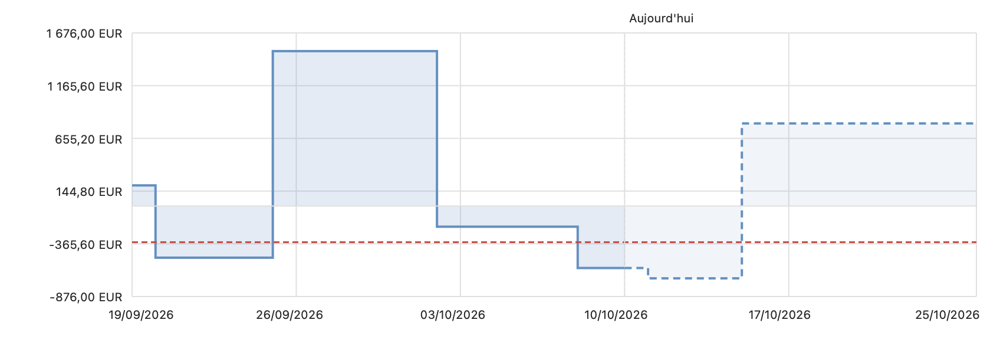

# HomeBank Panther

Native **Cocoa personal finance for Mac OS X Panther 10.3.9 on PowerPC**, compatible with unencrypted HomeBank `.xhb` files. Manage transactions and view balance forecasts on a vintage Mac; optional Google Drive synchronization is documented separately. This is a separate application compatible with the HomeBank file format.

**Published release: [0.6.0](https://github.com/invartam/homebank-panther/releases/tag/v0.6.0).** [User guide and real application screenshots](GUIDE_UTILISATEUR.md) · [Build and installation](README_TECHNIQUE.md).

## Compatibility and limits

- Unencrypted XHB files, format up to 1.6, maximum 8 MiB. Back up your wallet before editing.
- Scheduled transactions are read-only. Consolidate/export changes before reopening the file in the original HomeBank application; follow the user guide.
- Forecasts are estimates; salary detection and selected-date rules are explained in the French guide.

## Licensing and contributions

No project-wide licence was found. Bundled dependencies retain their notices, including [cJSON](vendor/cjson/LICENSE), [curl](resources/licenses/CURL-COPYING.txt) and [wolfSSL](resources/licenses/WOLFSSL-COPYING.txt). Public source availability alone is not a grant of redistribution rights for the whole application; the project licence needs an owner decision.

Report the application version, Mac/OS version and reproducible steps. Share synthetic examples rather than personal wallet files.

## Related projects

- [HomeBank Panther](https://github.com/invartam/homebank-panther): native personal finance on Mac OS X 10.3.9 PowerPC.
- [HomeBank Web](https://github.com/invartam/homebank-web): a HomeBank XHB personal finance PWA. [Open the web application](https://blog.benjy.lu/homebank-web/).
- [DWA-121 Panther driver](https://github.com/invartam/driver-dwa121-macosx-panther): USB Wi-Fi for a supported vintage Macintosh configuration.

## Guide en français

**Vos comptes, vos projets, votre Mac PowerPC.**

HomeBank Panther vous permet de gérer vos finances personnelles sur votre ancien Mac. Retrouvez vos comptes HomeBank, saisissez vos opérations et anticipez vos prochaines dépenses dans une application native conçue pour **Mac OS X 10.3.9**, avec une cible **iMac G3**.

Votre fichier reste au cœur de votre gestion : travaillez localement et synchronisez vos modifications avec Google Drive quand vous le décidez.

**Version 0.6.0** · **Mac PowerPC** · **Application native Cocoa** · **Fichiers HomeBank `.xhb`**

**[Télécharger le DMG PowerPC 0.6.0](https://github.com/invartam/homebank-panther/releases/download/v0.6.0/HomeBankPanther-0.6.0-ppc.dmg)** · [Notes de version et sources](https://github.com/invartam/homebank-panther/releases/tag/v0.6.0)

[Guide utilisateur illustré](GUIDE_UTILISATEUR.md) · [Le graphique](#votre-solde-dans-le-temps) · [Premiers pas](#premiers-pas) · [Installation et compilation](README_TECHNIQUE.md) · [Configurer Google Drive](DRIVE_SETUP.md)

## Gardez une vue claire sur vos finances

Retrouvez vos comptes ouverts et passez facilement de vos comptes bancaires à votre épargne. Chaque compte présente trois repères : le **solde rapproché**, le **solde pointé** et le **solde futur**.

Les couleurs tiennent compte du découvert autorisé. Les devises restent séparées pour consulter vos montants sans mélanger euros, dollars ou autres monnaies.

## Anticipez ce qu’il vous reste avant le prochain salaire

Le solde futur vous aide à estimer ce qui restera disponible avant votre prochaine rentrée de salaire. Il associe les opérations déjà inscrites aux échéances récurrentes encore à venir, **jusqu’au prochain salaire, dont la journée est exclue**.

La détection s’appuie sur le mémo et les catégories de vos opérations. Un revenu récurrent dominant peut également servir de repère ; l’application le signale alors comme **estimé**. Un salaire déjà inscrit à une date future est aussi pris en compte pour déterminer cette échéance.

Vous préférez choisir votre horizon ? Activez **Prévision à date choisie** et indiquez une date au format **jj/mm/aaaa**. Cette option est disponible sur **tous les comptes ouverts**, y compris l’épargne et les comptes avec salaire détecté. La journée choisie est incluse dans le calcul.

Désactivez l’option pour retrouver la prévision automatique avant salaire ou, sans salaire reconnu, le solde des opérations inscrites. Vos choix restent propres à chaque compte pendant la session. Les échéances en retard sont signalées et exclues de la projection ; un calcul incomplet est indiqué comme indisponible.

## Gérez vos opérations au quotidien

Saisissez vos dépenses, revenus et virements internes, puis retrouvez vos mouvements avec la recherche. Renseignez distinctement le **tiers**, le **mémo**, le **numéro de paiement** et la **catégorie**, avec ses sous-catégories.

Modifiez une opération, pointez-la ou rapprochez-la depuis votre compte. Les opérations futures apparaissent en gris et les suppressions demandent une confirmation. Les virements entre comptes sont liés, avec un montant propre à chaque compte lorsque les devises diffèrent.

## Retrouvez vos échéances dans un calendrier

Les vues **mensuelle** et **annuelle** donnent une lecture de vos opérations et de vos récurrences. Consultez l’ensemble des comptes ou un compte particulier, puis cliquez sur un jour ou un mois pour en afficher le détail.

Les dates passées et la journée en cours présentent les opérations inscrites. Les dates futures y ajoutent les échéances prévues. Revenus, dépenses et virements entrants ou sortants restent identifiables séparément. Les comptes clos sont consultables sur demande dans le calendrier.

Les planifications sont proposées en consultation ; leur création et leur modification restent dans HomeBank original.

## Votre solde dans le temps

Explorez l’évolution de votre solde avec une **courbe bleue légèrement remplie**, pour un compte, l’ensemble des comptes bancaires ou votre épargne. Parcourez plusieurs années et zoomez jusqu’au détail d’une journée.

*Capture du tracé natif sur un Mac récent, avec des données fictives. L’apparence des contrôles dépend de la version de macOS.*

Projetez vos opérations inscrites et vos échéances récurrentes sur **3 mois, 1 an ou 5 ans**. La partie prévisionnelle apparaît en pointillés. En vue individuelle, une **ligne rouge matérialise le découvert autorisé** du compte.

Le graphique conserve des horizons indépendants de la prévision avant salaire. Il respecte la devise sélectionnée et ne crée aucune opération.

## Travaillez localement, synchronisez à votre rythme

Vos comptes locaux restent accessibles **sans Internet et sans compte Google**. Les modifications sont enregistrées en arrière-plan dans un journal local, sans reconstruire tout le fichier XML après chaque action. Les prévisions sont également calculées en arrière-plan, avec réutilisation des résultats.

Cette organisation réduit le travail demandé lors de l’édition. Les performances restent dépendantes de votre Mac et de la taille du portefeuille.

Avec Google Drive configuré, chargez votre fichier partagé puis cliquez sur **Synchroniser** pour envoyer vos modifications dans une nouvelle révision. L’indicateur Drive vous permet de repérer les changements en attente. La synchronisation reste **manuelle**, et un conflit distant bloque l’envoi pour éviter un écrasement.

L’accès direct depuis Panther utilise un **compte de service Google** dont la clé est conservée dans le trousseau. Sa mise en place est décrite dans le [guide Google Drive](DRIVE_SETUP.md).

## Premiers pas

1. Téléchargez le DMG PowerPC, ouvrez-le et copiez **HomeBankPanther.app** dans **Applications**. Éjectez ensuite l’image et lancez l’application depuis Applications. Pour compiler vous-même, suivez le [guide technique](README_TECHNIQUE.md). Xcode n’est pas nécessaire pour exécuter le paquet fourni.
2. Ouvrez le [portefeuille de démonstration](tests/demo.xhb) pour découvrir les fonctions, puis une copie de votre fichier HomeBank.
3. Sélectionnez un compte pour consulter ses soldes et saisir vos opérations. Utilisez **Planifications** pour le calendrier et **Graphique** pour l’évolution du solde.
4. Activez une prévision à date choisie selon vos besoins. Si vous utilisez Drive, cliquez sur **Synchroniser** lorsque vous souhaitez transmettre vos changements.

### Retrouver vos changements dans HomeBank original

**Enregistrer confirme le journal local.** Pour transmettre un fichier `.xhb` autonome ou l’ouvrir avec vos dernières modifications dans HomeBank original, utilisez **Fichier > Consolider le fichier XML** ou **Exporter une copie**. La synchronisation Drive consolide automatiquement le XML avant l’envoi.

Tant que le fichier n’est pas consolidé, conservez le `.xhb` et son `.panther-journal` ensemble : HomeBank original ne lit pas ce journal. Les procédures de sauvegarde et de récupération sont détaillées dans le [guide technique](README_TECHNIQUE.md).

## Compatibilité

| Élément | Prise en charge |
| --- | --- |
| Machine cible | Mac PowerPC, notamment iMac G3, sous Mac OS X 10.3.9 |
| Interface | Application native Cocoa |
| Fichiers | HomeBank `.xhb` UTF-8 non chiffrés, jusqu’au format 1.6 et 8 Mio |
| Opérations | Dépenses, revenus, virements internes, pointage et rapprochement |
| Planifications | Consultation, calendrier et projections |
| Google Drive | Optionnel, accès direct par compte de service et synchronisation manuelle |

HomeBank Panther est un projet distinct de **HomeBank Web** et de l’application **HomeBank originale**. Il organise les opérations de votre fichier et n’effectue aucun paiement bancaire. Certaines modifications sont protégées sur les opérations rapprochées ou ventilées ; les détails figurent dans le guide technique.

La compilation et les tests sur un Mac récent ne remplacent pas la validation dans Panther. Le rendu et les performances de cette version restent à vérifier sur le matériel PowerPC cible.

## Pour aller plus loin

- [Guide utilisateur illustré](GUIDE_UTILISATEUR.md) : parcours détaillés et captures prises sous OS X 10.3.9 dans la VM Panther.
- [Guide technique](README_TECHNIQUE.md) : compilation, installation, tests, sauvegarde locale et récupération.
- [Configuration Google Drive](DRIVE_SETUP.md) : compte de service, partage du fichier, synchronisation et conflits.
- [Kit HTTPS PowerPC](HTTPS_BUILD.md) : préparation des composants réseau pour Panther.
